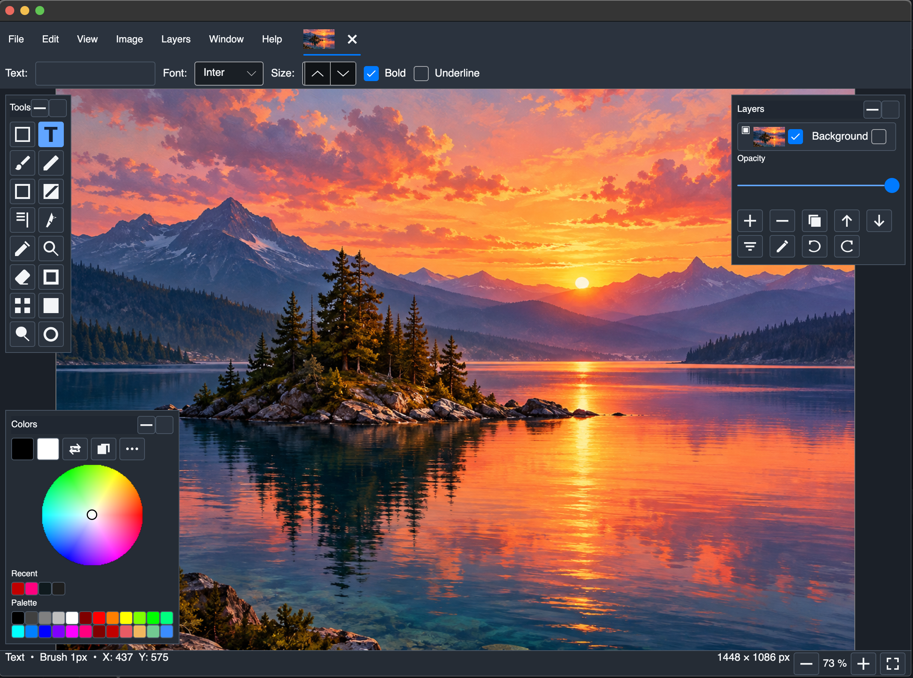

# Bruskel

Bruskel is a cross-platform raster editor focused on a familiar reference-style
workflow: a canvas in the center, dockable tool windows, document tabs, layers,
and direct keyboard shortcuts.



Bruskel 0.0.3-alpha with a document open in the Avalonia interface. This
first screenshot shows the full-window canvas, document thumbnail tab, tool
palette, color controls, and layers panel in the reference-inspired layout.

## Current alpha

The current Avalonia alpha is **0.0.4-alpha**. It includes:

- document tabs with thumbnails and drag-to-reorder;
- a compact save/discard dialog for unsaved documents;
- a clean 800 × 600 canvas on startup;
- layers, history, colors, tools, zoom, and canvas navigation;
- shared raster algorithms used by platform adapters.

### Tool architecture decisions

The `Shapes` tool intentionally follows the established reference editor layout: one
Shapes tool exposes the supported shape kinds and their shared options. This is
a fixed product decision; do not split it into separate toolbox buttons.

Avalonia now also exposes a dedicated **Pan** tool with reference-style viewport
dragging. Middle-button dragging and temporary Space/H dragging remain available.

Brush parity is being completed incrementally. Precise (subpixel) size, optional
pressure scaling, round/square tip geometry, spacing, and smoothing are now part
of the Avalonia brush model; brush fill-style parity and pressure-device QA are
still pending.

## Run from a release build

From the published application directory:

```sh
./Bruskel
```

The application opens directly into a clean 800 × 600 canvas. Use **File → New**
or **Image → Resize canvas** when a different size is needed.

## Build from source

```sh
dotnet build src/platform/avalonia/Bruskel.Avalonia/Bruskel.Avalonia.csproj -c Release
dotnet test tests/Bruskel.Avalonia.Tests/Bruskel.Avalonia.Tests.csproj --no-restore -m:1
```

See the [tool reference](tools/README.md) for more detail.

## Project status

Bruskel is an alpha project. UI behavior and platform boundaries are changing
as the GTK and Avalonia implementations are aligned around shared core logic.
